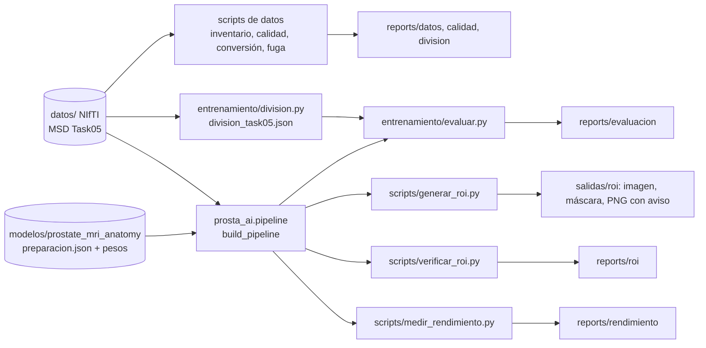

# Arquitectura

## Estructura de carpetas

```
backend/
  pyproject.toml            paquete prosta-ai 0.4.0 y versiones fijadas
  prosta_ai/
    constantes.py           AVISO_EXPERIMENTAL (texto del aviso no diagnóstico)
    pipeline/               etapas del procesamiento (ver codigo.md)
    recursos/               fuente DejaVu Sans y su licencia (texto del aviso)
  tests/                    pruebas del pipeline y del entrenamiento
scripts/                    datos, control de calidad, ROI, rendimiento y verificaciones
entrenamiento/              división por paciente, evaluación, ajuste fino y cuaderno de Colab
reports/                    informes generados: datos/, calidad/, division/, evaluacion/, rendimiento/, roi/
tests/                      pruebas de los scripts de datos
docs/, docs-tecnicos/       documentación de gestión, requisitos, datos y modelo
datos/, modelos/, salidas/  locales, fuera de git (.gitignore)
```

## Componentes

- **Paquete `prosta_ai.pipeline`:** núcleo reutilizable. `base.Segmentation3DPipeline` ejecuta cinco etapas en
  orden fijo y comparte el estado en un `PipelineContext`.
- **Modelo:** carpeta `modelos/<nombre>/` con `preparacion.json` y pesos. `factory.build_pipeline` elige la
  estrategia de segmentación a partir de esa carpeta.
- **Scripts (`scripts/`) y entrenamiento (`entrenamiento/`):** clientes de línea de comandos. Los de datos
  trabajan sobre `datos/`; los de ROI, evaluación y rendimiento usan `build_pipeline`, la misma ruta que usará
  la aplicación web prevista.
- **Informes (`reports/`):** salida en Markdown/CSV; solo cifras, nunca imágenes de pacientes.



## Módulos del pipeline

```mermaid
flowchart TB
    factory[factory.py<br/>build_pipeline, model_info] --> base[base.py<br/>BasePipeline / Segmentation3DPipeline]
    factory --> seg[segmentation.py<br/>create_strategy, PretrainedUNetStrategy]
    base --> io[io.py<br/>load_volume, save_nifti]
    base --> val[validators.py<br/>detailed_validation]
    base --> prep[preparation.py<br/>prepare_volume]
    base --> seg
    base --> roi[roi.py<br/>mask_to_original_space]
    base --> ev[evaluation.py<br/>dice, iou]
    base --> prog[progress.py<br/>PipelineProgress, TimingRecorder]
    seg --> prep
    roi --> prep
    io & val & prep & seg & roi --> err[errors.py<br/>StageError]
    err --> st[stages.py<br/>nombres de etapas]
    vis[visualizacion.py<br/>guardar_imagen_roi] --> const[constantes.py<br/>AVISO_EXPERIMENTAL]
    vis -. lee imagen.nii.gz y mascara.nii.gz .-> base
```

Patrones usados (declarados en los docstrings): Template Method (`base.py`), Chain of Responsibility
(`validators.py`), Adapter (`io.py`), Strategy + Factory Method (`segmentation.py`), Observer (`progress.py`),
Strategy + Decorator (`visualizacion.py`).
