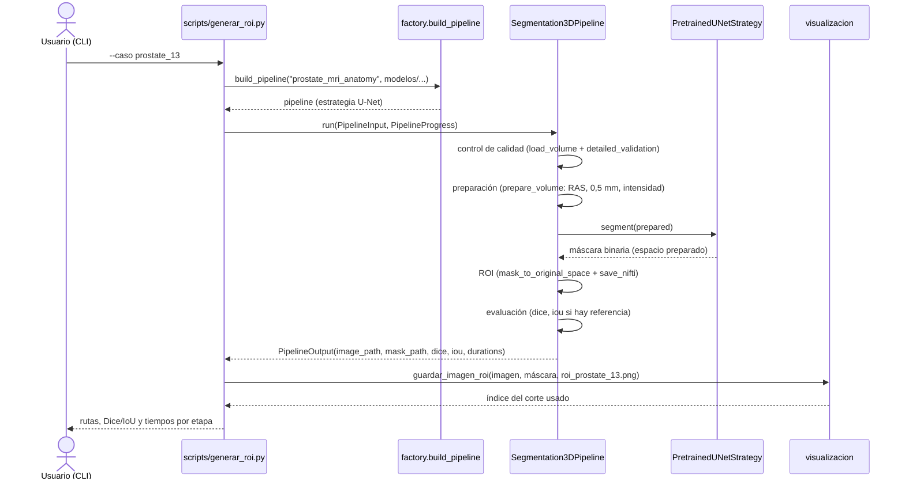

# Flujo de procesamiento

Entrada: un estudio NIfTI (3D, o 4D del que se toma el canal 0 = T2) y, opcionalmente, una máscara de
referencia NIfTI. Salida: `imagen.nii.gz`, `mascara.nii.gz` (misma forma y afín), un PNG con el aviso y, si hay
referencia, Dice e IoU. Lo orquesta `BasePipeline.run` (`backend/prosta_ai/pipeline/base.py`).

## Paso a paso

1. **Control de calidad.** `load_volume` lee el NIfTI (`io.py`); `detailed_validation` aplica
   `IntegrityValidator` y `MetadataValidator` (`validators.py`). La referencia se binariza (> 0).
2. **Preparación.** `prepare_volume` aplica las transformaciones de `preparacion.json`: orientación RAS,
   remuestreo a 0,5 mm, escala [0, 1] y normalización (`preparation.py`).
3. **Segmentación.** `PretrainedUNetStrategy.segment` infiere por ventana deslizante 96³, toma `argmax`,
   conserva la mayor componente de cada etiqueta y une las etiquetas 1 y 2 en una máscara binaria
   (`segmentation.py`).
4. **ROI.** `mask_to_original_space` devuelve la máscara a la rejilla original por vecino más cercano; se
   guardan `imagen.nii.gz` y `mascara.nii.gz` sin texto libre en la cabecera (`roi.py`, `io.save_nifti`).
5. **Evaluación.** Si hay referencia, `dice` e `iou` se calculan en la rejilla original (`evaluation.py`).
6. **Imagen con aviso** (fuera del pipeline, en `scripts/generar_roi.py`): `guardar_imagen_roi` dibuja el corte
   axial con más ROI, la superposición y la banda con `AVISO_EXPERIMENTAL` (`visualizacion.py`).

Cualquier fallo se convierte en `StageError(etapa, mensaje)` y se notifica a los observadores con
`notify_failed`; `TimingRecorder` guarda la duración de cada etapa terminada.

