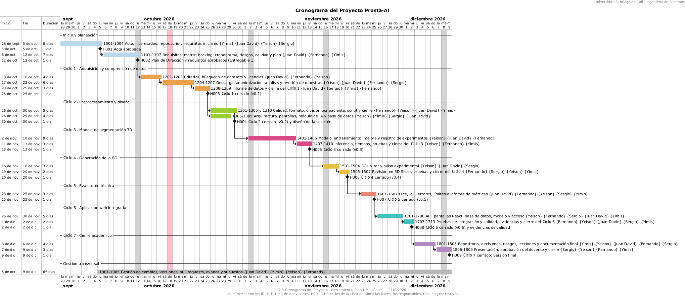

# Cronograma del proyecto

Diagrama de Gantt con los ciclos, las actividades por rango de ID, los hitos H001 a H009 y la gestión transversal, del 28/09 al 09/12/2026.

## Ficha

| Campo | Detalle |
|---|---|
| Paquete EDT | 1.2.2.3 |
| Fecha y versión | 11/10/2026 (versión corregida) |
| Responsable | Planeación y líder del proyecto |
| Formato | Imagen PNG generada con PlantUML (Gantt) |

## Contenido principal

| Etapa | Fechas | Actividades | Hito de cierre |
|---|---|---|---|
| Inicio y planeación | 28/09 a 12/10 | 1001 a 1004 y 1101 a 1107 | H001 (05/10) y H002 (12/10) |
| Ciclo 1, datos | 13/10 a 25/10 | 1201 a 1209 | H003 (25/10) |
| Ciclo 2, preprocesamiento y diseño | 26/10 a 30/10 | 1301 a 1310 | H004 (30/10) |
| Ciclo 3, modelo 3D | 02/11 a 13/11 | 1401 a 1410 | H005 (13/11) |
| Ciclo 4, ROI | 16/11 a 20/11 | 1501 a 1507 | H006 (20/11) |
| Ciclo 5, evaluación técnica | 23/11 a 25/11 | 1601 a 1607 | H007 (25/11) |
| Ciclo 6, aplicación web integrada | 26/11 a 02/12 | 1701 a 1713 | H008 (02/12) |
| Ciclo 7, cierre académico | 03/12 a 09/12 | 1801 a 1809 | H009 (09/12) |
| Gestión transversal | 05/10 a 09/12 (66 días) | 1901 a 1905 | |

Los números del diagrama son los ID de la [Lista de actividades](lista-de-actividades.md) y los H001 a H009 son los de la [Lista de hitos](lista-de-hitos.md); las llaves indican los responsables y los días en gris son festivos.

## Documento original

* [Cronograma (PNG)](https://github.com/yimis-source/ProstaAIReal/tree/main/docs) — `docs/docsf/1.2 Planeación/1.2.2.3 Cronograma del proyecto (corregido).png`
