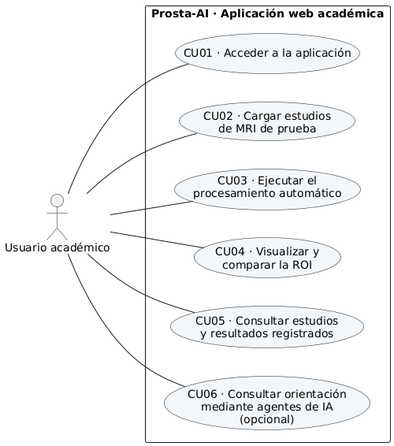

# Diagrama de casos de uso

Modelo UML de las interacciones del usuario académico con Prosta-AI; sustenta los requisitos funcionales y el diseño de las pantallas.

## Ficha

| Campo | Detalle |
|---|---|
| Paquete EDT | 1.3.1.1 |
| Fecha y versión | No indicadas; archivo marcado «corregido» |
| Responsable | Analista y diseñador, según la EDT del Plan de alcance |
| Formato | Imagen PNG |

## Contenido principal

* **Actor único:** el usuario académico (estudiante o docente).
* **CU01** Acceder a la aplicación.
* **CU02** Cargar estudios de MRI de prueba.
* **CU03** Ejecutar el procesamiento automático.
* **CU04** Visualizar y comparar la ROI.
* **CU05** Consultar estudios y resultados registrados.
* **CU06** Consultar orientación mediante agentes de IA (opcional).
* Los casos de uso se enlazan con los requisitos en el [SRS](requisitos.md) y con las pantallas del [diseño de interfaz](diseno-de-interfaz.md).

## Documento original

* [Diagrama de casos de uso (PNG)](https://github.com/yimis-source/ProstaAIReal/tree/main/docs) — `docs/docsf/1.3 Ejecución/1.3.1.1 Requerimientos - Caso de uso (corregido).png`
* [Resumen en Markdown del repositorio](https://github.com/yimis-source/ProstaAIReal/tree/main/docs) — `docs/ejecucion/01_requisitos.md`
